# Joe Security Report Phishing – Outlook Add-in Deployment Guide

**Latest version:** 1.0.0 · **Release date:** TBD

The Joe Security Report Phishing add-in lets Outlook users report a suspicious email to **Joe Sandbox** with one click. The complete original email (headers, body and all attachments) is submitted to Joe Sandbox as an `.eml` file for analysis.

---

## Table of Contents

- [Introduction](#introduction)
  - [Microsoft Outlook Add-ins](#microsoft-outlook-add-ins)
  - [About Joe Security](#about-joe-security)
  - [How it works](#how-it-works)
- [Prerequisites](#prerequisites)
- [Installation Steps](#installation-steps)
  - [Phase 1 – Azure App Registration](#phase-1--azure-app-registration)
  - [Phase 2 – Deploy the Web App](#phase-2--deploy-the-web-app)
  - [Phase 3 – Configure the App Registration](#phase-3--configure-the-app-registration)
  - [Phase 4 – Deploy the Add-in via the Microsoft 365 Admin Center](#phase-4--deploy-the-add-in-via-the-microsoft-365-admin-center)
  - [Phase 5 – Verification](#phase-5--verification)
- [Post-Deployment Validation Checklist](#post-deployment-validation-checklist)
- [Changing Settings After Deployment](#changing-settings-after-deployment)
- [Troubleshooting](#troubleshooting)
- [Version History](#version-history)

---

## Introduction

### Microsoft Outlook Add-ins

Microsoft Outlook add-ins are web-based extensions that integrate directly into Outlook on Windows and Mac, Outlook on the web and the new Outlook. They let organizations add their own workflows to the mailbox. Using Microsoft 365 single sign-on (SSO) and the Microsoft Graph API, add-ins work with mailbox data without storing user credentials.

### About Joe Security

Joe Security develops **Joe Sandbox**, a platform for deep malware analysis. Joe Sandbox analyzes files, URLs and emails in a controlled environment and reports their behavior and indicators, so security teams can quickly decide whether something is malicious.

The **Joe Security Report Phishing** add-in enables users to:

- Report a suspicious email with a single click.
- Submit the original email, including all attachments, to Joe Sandbox for analysis.
- Optionally move the reported email to a dedicated Outlook folder.
- Sign in seamlessly with Microsoft 365 SSO.

### How it works

1. The user opens a suspicious email, clicks **Report Phishing** and confirms.
2. The add-in signs the user in with Microsoft 365 SSO and sends the message ID to the add-in's Web App, hosted in your Azure subscription.
3. The Web App downloads the original email from Microsoft Graph and submits it to Joe Sandbox, tagged `Outlook Add-in` and with the reporting user's address.
4. Optionally, the email is moved to a folder such as **Phishing Report**.

**Data handling:**

- The email is **not forwarded** to any mailbox and is **never stored**: it is held in memory only while it is being submitted.
- No user credentials or user tokens are stored.
- The reporting user's address is sent to Joe Sandbox as part of the analysis tag and comment, so that analysts can see who reported the email.

---

## Prerequisites

- **Azure subscription:** to create the App Registration and host the Web App (Azure App Service, Linux).
  - The deployment briefly runs a deployment script. It uses a temporary storage account and container instance, which Azure deletes afterwards. The resource providers `Microsoft.Storage` and `Microsoft.ContainerInstance` must therefore be registered in the subscription (**Subscription → Settings → Resource providers**). They usually are.
- **Microsoft 365 administrator account:** to register the application, grant admin consent and deploy the add-in.
- **Joe Sandbox account and API key:** Joe Sandbox Cloud or an on-premise Joe Sandbox. To use Joe Reverser, the account must include it.

---

## Installation Steps

### Phase 1 – Azure App Registration

1. Open the [Azure portal](https://portal.azure.com) and search for **Microsoft Entra ID**.
2. Click **Add → App registration**.

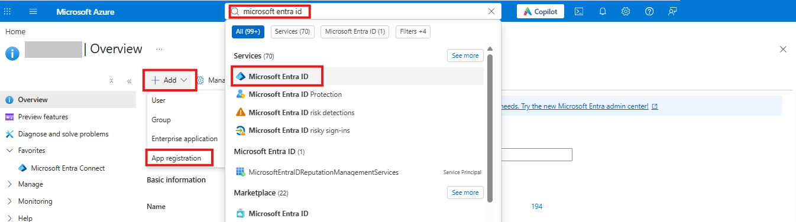

3. Fill in:
   - **Name:** `JoeSecurity-Outlook-Addin`
   - **Supported account types:** *Single tenant only* (accounts in this organizational directory only)
   - **Redirect URI:** leave empty for now.
4. Click **Register**.

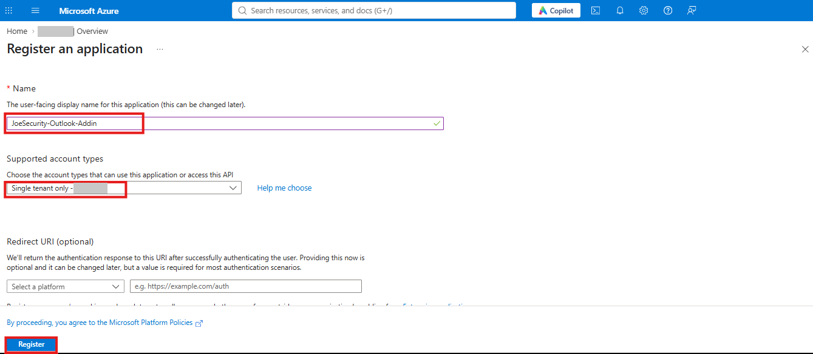

5. On the **Overview** page, copy and save:
   - **Application (client) ID**
   - **Directory (tenant) ID**

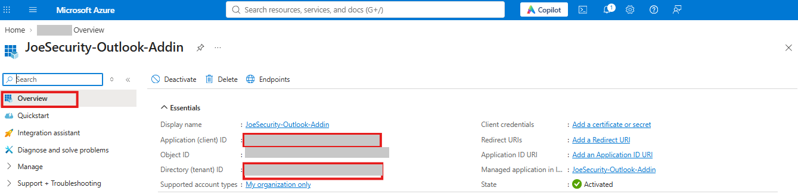

6. Go to **Manage → Certificates & secrets** and click **+ New client secret**.
7. Enter a description, choose an expiry and click **Add**.
8. Immediately copy the secret **Value** and store it securely.

> **Note:** the secret value is shown only once. You need it in Phase 2. Before the secret expires, create a new one and update the Web App setting `AZURE_CLIENT_SECRET` (see [Changing Settings After Deployment](#changing-settings-after-deployment)).

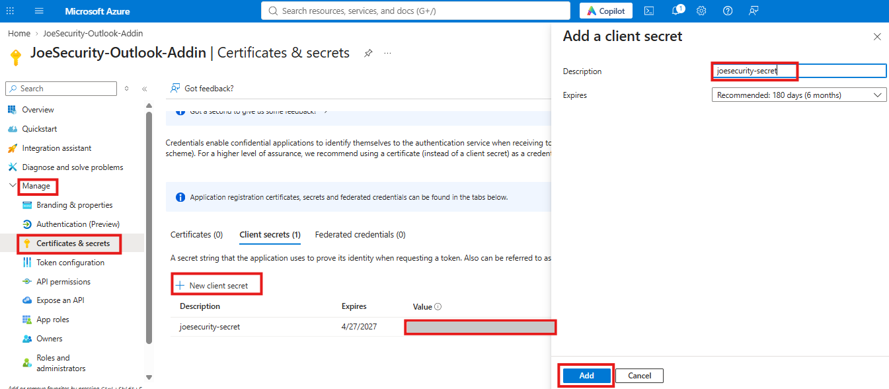

9. Go to **Manage → API permissions** and click **+ Add a permission**.
10. Select **Microsoft Graph → Delegated permissions**, then search for and select each of these permissions:
    - `openid`
    - `profile`
    - `User.Read`
    - `Mail.ReadWrite`
11. Click **Add permissions**.

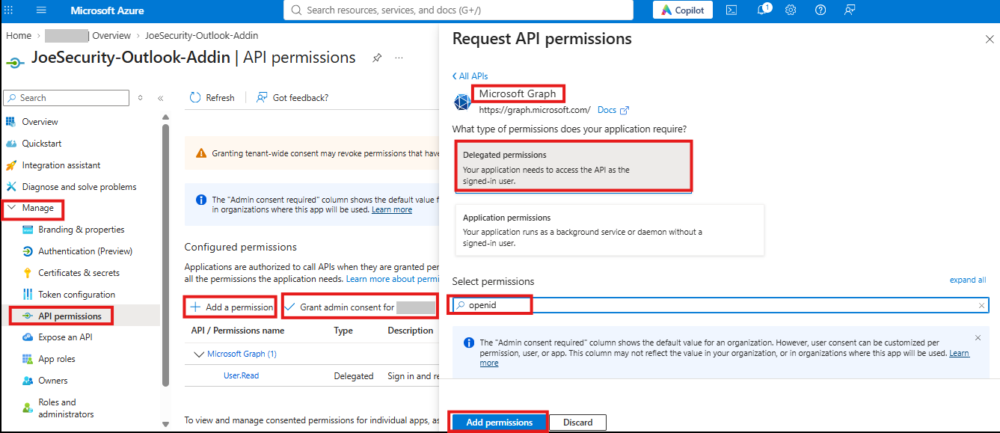

12. Click **Grant admin consent for \<your organization\>** and confirm.

> `Mail.ReadWrite` is needed to move reported emails to a folder. If you will never use that option, `Mail.Read` is enough.

---

### Phase 2 – Deploy the Web App

1. Click the button below to deploy the Web App to your Azure subscription:

   [](https://portal.azure.com/#create/Microsoft.Template/uri/https%3A%2F%2Fraw.githubusercontent.com%2F%7BJOE_GITHUB_ORG%7D%2F%7BJOE_REPOSITORY%7D%2Fmain%2Fdeploy%2Fazuredeploy.json)

2. On the **Custom deployment** page, fill in the parameters:

| Field | Description |
| :--- | :--- |
| Subscription | Select the Azure subscription. |
| Resource Group | Select or create a resource group. |
| Region | Filled in from the resource group. |
| Web App Name | A name for the Web App. It forms the add-in's address (`<name>.azurewebsites.net`). |
| Sku | App Service pricing tier. `B1` is fine for testing; `S1` or higher is recommended for production. |
| Azure Tenant ID | Directory (tenant) ID from Phase 1. |
| Azure Client ID | Application (client) ID from Phase 1. |
| Azure Client Secret | Client secret value from Phase 1. |
| Joe Sandbox Api Url | Keep the default `https://jbxcloud.joesecurity.org/api` for Joe Sandbox Cloud. For on-premise Joe Sandbox, use `https://<your-server>/joesandbox/index.php/api`. |
| Joe Sandbox Api Key | Your Joe Sandbox API key. |
| Accept Joe Sandbox Terms And Conditions | Set to **true** for Joe Sandbox Cloud. This confirms you accept the [Terms and Conditions](https://jbxcloud.joesecurity.org/resources/termsandconditions.pdf). |
| Analyze On Joe Reverser | **true** to also analyze reported emails with Joe Reverser (the account must include Joe Reverser). |
| Move Reported Email To Folder | **true** to move the email to a folder after it is submitted successfully. |
| Reported Email Folder Name | Folder for reported emails (default `Phishing Report`). It is created if it does not exist. |
| Max Email Size MB | Largest email that may be submitted (default 25 MB). |
| Deployment Timestamp | Leave as is. |
| Package Url | Leave as is. |

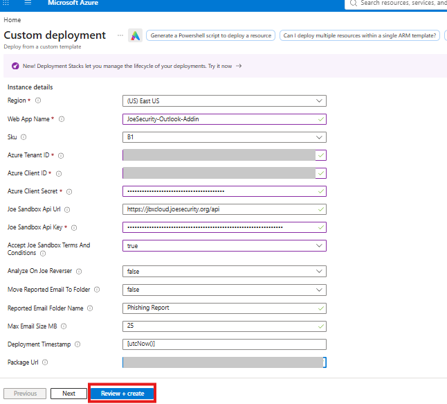

3. Click **Review + create**, then **Create**. The deployment takes about 5 minutes.
4. When the deployment is complete, open **Outputs** and copy **webAppURL**, for example `https://joesecurity-outlook-addin.azurewebsites.net`. The host name in it (`joesecurity-outlook-addin.azurewebsites.net`) is called **YOUR-DOMAIN** in the steps below.

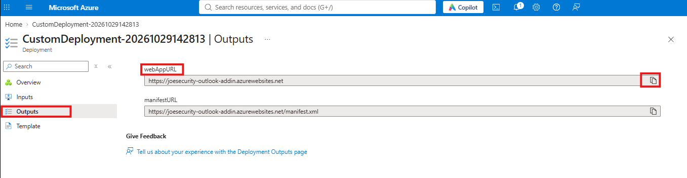

5. Open `https://YOUR-DOMAIN/health` in a browser. It should show `"status":"ok"` and `"configured":true`.

---

### Phase 3 – Configure the App Registration

Open the App Registration from Phase 1 again.

1. Go to **Manage → Authentication** and click **+ Add Redirect URI**.
2. Select **Single-page application** and enter:

   ```
   https://YOUR-DOMAIN/fallbackauthdialog.html
   ```

3. Click **Configure**.

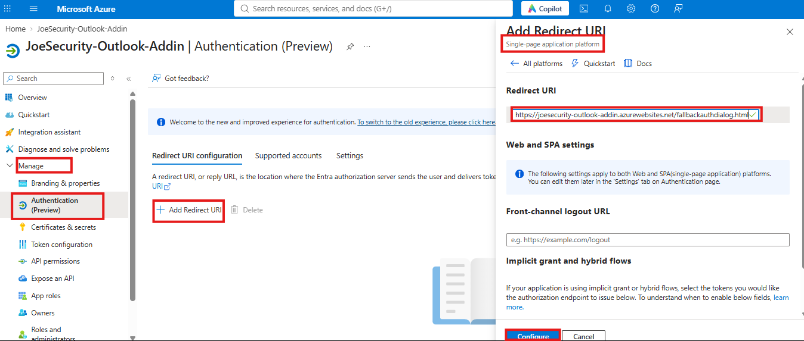

4. Go to **Manage → Expose an API**. Next to **Application ID URI**, click **Add**, set it to the following and click **Save**:

   ```
   api://YOUR-DOMAIN/CLIENT-ID
   ```

   Replace `CLIENT-ID` with the Application (client) ID from Phase 1.

5. Click **+ Add a scope** and fill in:
   - **Scope name:** `access_as_user`
   - **Who can consent:** Admins only
   - **Admin consent display name:** `Access Joe Security Outlook Add-in`
   - **Admin consent description:** `Allows the Outlook add-in to call its middle tier on behalf of the signed-in user.`
   - **State:** Enabled
6. Click **Add scope**.

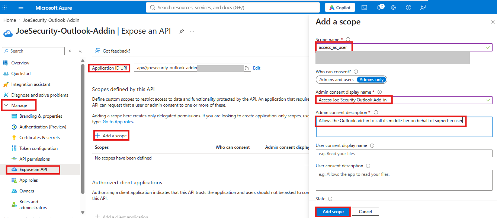

7. Under **Authorized client applications**, click **+ Add a client application**.
8. In **Client ID**, enter the following (it authorizes all Microsoft Office applications):

   ```
   ea5a67f6-b6f3-4338-b240-c655ddc3cc8e
   ```

9. Tick the `access_as_user` scope under **Authorized scopes** and click **Add application**.

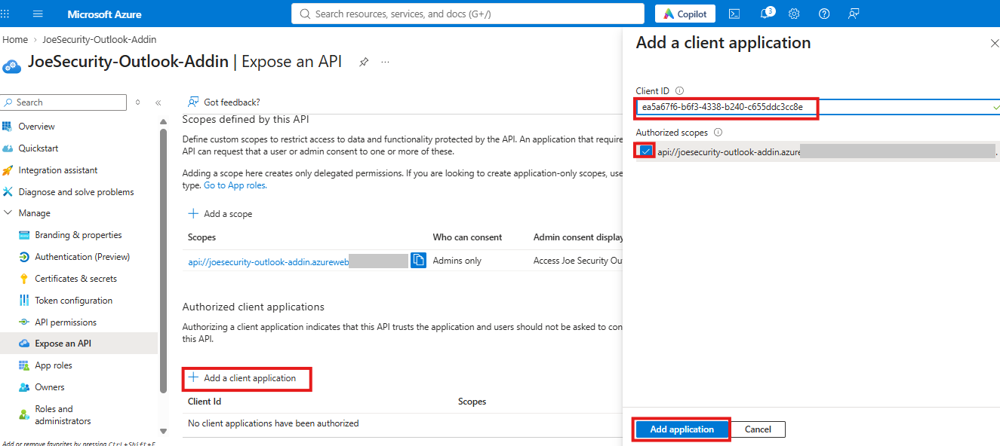

---

### Phase 4 – Deploy the Add-in via the Microsoft 365 Admin Center

The Web App provides the add-in manifest with your domain and client ID already filled in:

```
https://YOUR-DOMAIN/manifest.xml
```

1. Open the [Microsoft 365 admin center](https://admin.microsoft.com) with a Global Administrator account.
2. Go to **Settings → Integrated apps** and click **Upload custom apps**.

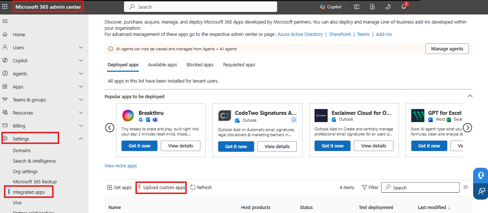

3. For **App type**, select **Office Add-in**. Then either:
   - select **Provide link to manifest file**, enter `https://YOUR-DOMAIN/manifest.xml` and click **Validate**, or
   - download `https://YOUR-DOMAIN/manifest.xml`, then select **Upload manifest file (.xml) from device** and choose the file.
4. Click **Next**.

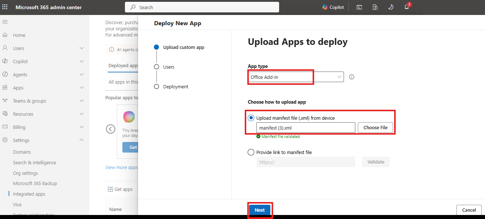

5. Choose who receives the add-in:
   - **Just me:** recommended for a first test.
   - **Specific users/groups:** group membership changes are applied automatically.
   - **Entire organization.**
6. Review and accept the requested permissions, then click **Deploy**.
7. When **Deployment completed** appears, click **Done**.

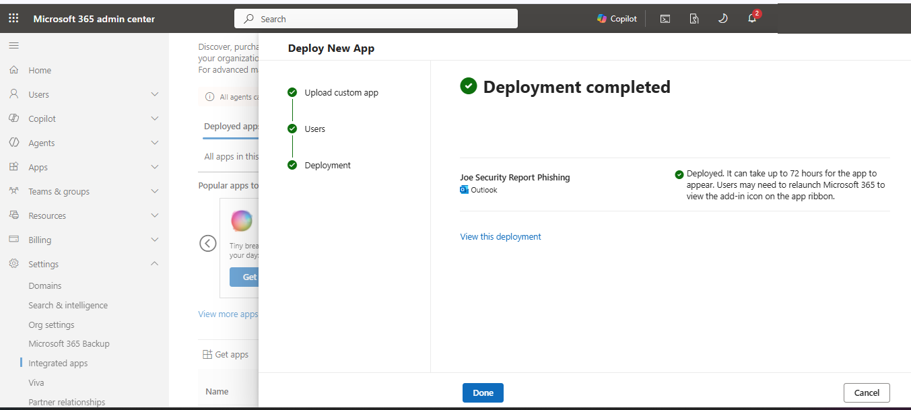

> **Note:** it can take up to 24 hours (in rare cases 72) before the add-in appears for users. Signing out of Outlook and back in usually speeds this up.

---

### Phase 5 – Verification

1. Open any email in Outlook.
2. Click **Report Phishing**:
   - **Classic Outlook (Windows/Mac):** on the ribbon, in the **Joe Security** group.
   - **Outlook on the web / new Outlook:** in the message toolbar, under **Apps**. Users can pin it for one-click access.
3. The task pane opens and shows the email's subject. Click **Report**.

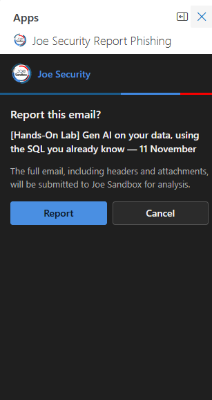

4. The task pane shows **Submitted to Joe Sandbox.**

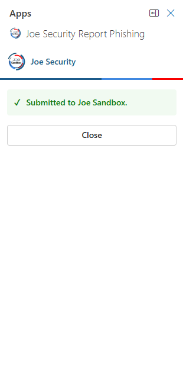

5. In Joe Sandbox, a new analysis appears with:
   - the tags `Outlook Add-in` and the reporter's address in tag form (for example `first_last_contoso_com`),
   - the comment `Reported via Outlook Add-in by <user>`.
6. If **Move Reported Email To Folder** is enabled, the email moves to the configured folder.

---

## Post-Deployment Validation Checklist

- [ ] `https://YOUR-DOMAIN/health` returns `"status":"ok"` and `"configured":true`
- [ ] The add-in is visible in Outlook on the web and in desktop Outlook
- [ ] SSO works without a sign-in prompt for an already signed-in user
- [ ] A reported email (with attachments) appears as a new analysis in Joe Sandbox
- [ ] An email larger than **Max Email Size MB** is rejected with a clear message
- [ ] Move-to-folder behaves as configured

---

## Changing Settings After Deployment

All settings are stored as **Environment variables** of the Web App. To change one:

1. Open **App Service → your Web App → Settings → Environment variables**.
2. Edit the value and click **Apply**, then **Confirm**. The Web App restarts automatically.

| Setting | Description |
| :--- | :--- |
| `AZURE_TENANT_ID` | Directory (tenant) ID |
| `AZURE_CLIENT_ID` | Application (client) ID |
| `AZURE_CLIENT_SECRET` | Client secret. Update it before it expires. |
| `JOE_API_URL` | Joe Sandbox API URL |
| `JOE_API_KEY` | Joe Sandbox API key |
| `JOE_ACCEPT_TAC` | `true` to accept the Joe Sandbox Cloud Terms and Conditions |
| `JOE_ANALYZE_ON_REVERSER` | `true` to also analyze with Joe Reverser |
| `MOVE_REPORTED_EMAIL_TO_FOLDER` | `true` to move reported emails to a folder |
| `REPORTED_EMAIL_FOLDER_NAME` | Name of that folder |
| `MAX_EMAIL_SIZE_MB` | Maximum email size for submission |
| `APP_DOMAIN` | Only for a custom domain: the domain users reach the Web App on |

> **Tip:** for production, consider storing `AZURE_CLIENT_SECRET` and `JOE_API_KEY` in Azure Key Vault and referencing them from these settings ([Key Vault references](https://learn.microsoft.com/azure/app-service/app-service-key-vault-references)).

---

## Troubleshooting

To see what the Web App is doing, open **App Service → your Web App → Monitoring → Log stream** and report an email again. Email content is never logged.

| Symptom | Cause and solution |
| :--- | :--- |
| `/health` shows `"configured": false` | A required setting is empty. The log stream lists the missing setting names. |
| Clicking the add-in does nothing (Outlook on the web) | A browser privacy feature or extension (for example Brave Shields or an ad blocker) blocks the add-in. Allow Outlook and `YOUR-DOMAIN`, then reload Outlook. |
| The add-in does not appear in Outlook | Deployment can take up to 24 hours. Sign out of Outlook and back in, or restart Outlook. |
| "Your sign-in could not be verified" | The **Application ID URI** (Phase 3, step 4) is not exactly `api://YOUR-DOMAIN/CLIENT-ID`. |
| The sign-in window shows a redirect URI error | The **Single-page application** redirect URI (Phase 3, step 2) is missing or has a typo. |
| "Permission to read this email has not been granted" | Admin consent is missing (Phase 1, step 12). |
| "The add-in's Microsoft 365 app registration is misconfigured" | The client secret is wrong or has expired. Create a new secret and update `AZURE_CLIENT_SECRET`. |
| "Joe Sandbox rejected the configured API key" | Check `JOE_API_KEY`. |
| "Terms and Conditions have not been accepted" | Set `JOE_ACCEPT_TAC` to `true` (Joe Sandbox Cloud). |
| "Not permitted to make this submission" | The Joe Sandbox account does not allow this submission, for example because it does not include Joe Reverser. Set `JOE_ANALYZE_ON_REVERSER` to `false`. |
| "The Joe Sandbox submission quota has been reached" | The account's quota is used up. Try again later or increase the quota. |
| The deployment fails at the `waitForWebApp` step | The `Microsoft.ContainerInstance` or `Microsoft.Storage` resource provider is not registered, or an Azure Policy blocks the temporary resources. See [Prerequisites](#prerequisites). |

---

## Version History

| Version | Release Date | Release Notes |
| :--- | :--- | :--- |
| 1.0.0 | TBD | <ul><li>Initial release</li><li>Outlook add-in that submits reported emails to Joe Sandbox for analysis</li><li>Azure Web App deployment template with Microsoft 365 SSO</li><li>Optional move of reported emails to a folder, and optional Joe Reverser analysis</li></ul> |
